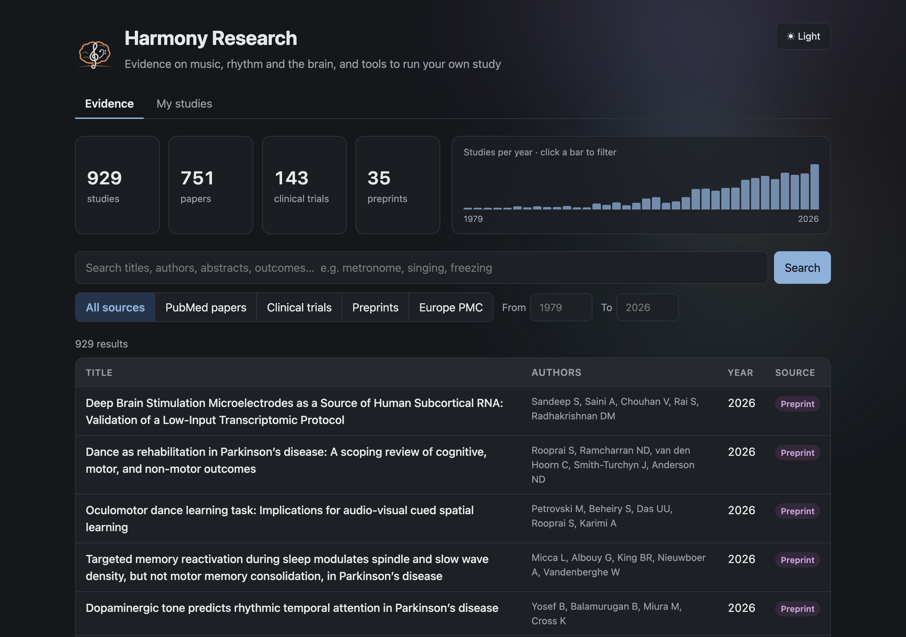

<p align="center">
  
</p>

<h1 align="center">Harmony Research</h1>

<p align="center">
  An open evidence base on music, rhythm and the brain, plus tools to design and run your own music study.
</p>



## What it does

**Evidence browser.** Pulls public research into one searchable place:

- **PubMed** papers on music, singing, metronome and rhythmic auditory cueing in Parkinson's disease
- **ClinicalTrials.gov** trials, with enrollment and primary outcomes
- **Europe PMC**, which adds preprints (clearly labelled as not peer reviewed), PubMed Central-only papers and theses

Search titles, authors, abstracts and outcomes; filter by source and year; open any row to read the abstract.

**Study builder.** Design an n-of-1 study: one person comparing a few conditions (an instrument, a tempo, a playlist, silence) over randomized daily sessions.

- Block-randomized schedule, so every condition appears once per round and none clusters on good or bad weeks
- Log mood and focus (1–10) before and after each session, with notes
- See the average change per condition, with every session plotted and small-sample caveats

> The study builder tracks how music affects how you feel. It isn't a medical device or treatment.

## Run it locally

Prerequisites: Python 3.11+, PostgreSQL 14+, Node.js 18+.

```bash
# 1. Database
createdb harmony_db
cp .env.example backend/.env   # set DATABASE_URL, e.g. postgresql://<you>@localhost:5432/harmony_db

# 2. Backend
cd backend
python3 -m venv venv
./venv/bin/pip install -e .
./venv/bin/alembic upgrade head

# 3. Pull evidence (a few minutes, all public APIs)
PYTHONPATH=. ./venv/bin/python scripts/pull_pubmed.py
PYTHONPATH=. ./venv/bin/python scripts/pull_clinicaltrials.py
PYTHONPATH=. ./venv/bin/python scripts/pull_europepmc.py

# 4. Optional: example studies with made-up sessions to explore
PYTHONPATH=. ./venv/bin/python scripts/seed_example_studies.py

# 5. Start the API (:8000) and web UI (:3000) together
cd .. && ./dev.sh
```

Open http://localhost:3000. API docs are at http://localhost:8000/docs.

## Tests

```bash
cd backend && ./venv/bin/python -m pytest
cd web && npm test
```

## Project structure

```
backend/   FastAPI + SQLAlchemy + Alembic (PostgreSQL)
  app/integrations/   PubMed, ClinicalTrials.gov, Europe PMC clients
  app/api/            /api/evidence and /api/studies routes
  scripts/            data pulls and example studies
web/       React + TypeScript + Vite
docs/      design, plans, research foundation, brand, screenshots
```

## Roadmap

- **Phase 1, evidence aggregator** ✅ PubMed, ClinicalTrials.gov, Europe PMC, web UI
- **Study builder (early Phase 3)** ✅ personal n-of-1 studies
- **Phase 2, gap finder:** extract tempo, instrument and outcome details from abstracts; map what's under-studied
- **Toward clinical use:** see [docs/plans/2026-10-22-clinician-platform-plan.md](docs/plans/2026-10-22-clinician-platform-plan.md)

Background: [design](docs/design/music-therapy-research-design.md) · [phase 1 plan](docs/plans/2026-10-17-music-therapy-phase1-plan.md) · [psychoacoustics foundation](docs/research-foundation/psychoacoustics.md)

## Contributing

Music therapists, researchers and developers are very welcome. Open an issue or a pull request.

## License

MIT. See [LICENSE](LICENSE).
